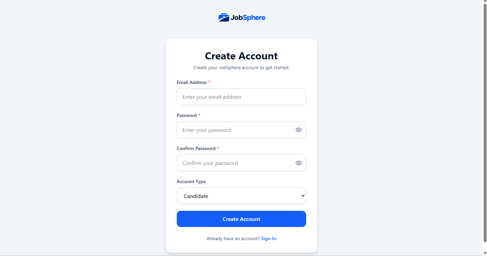
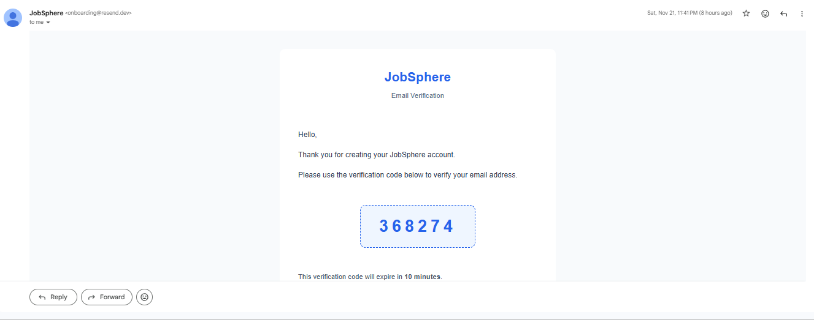
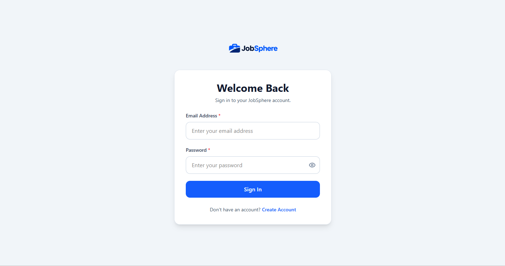
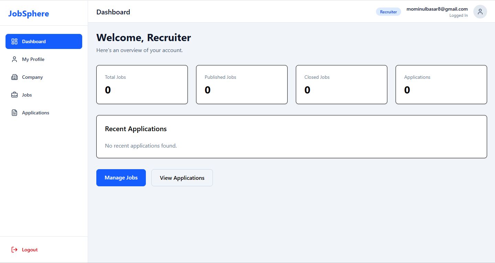
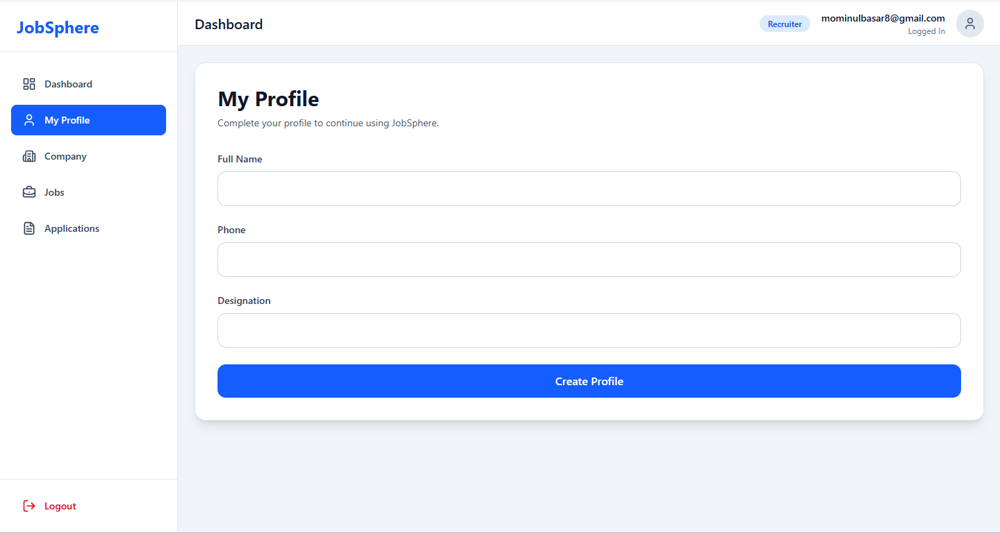
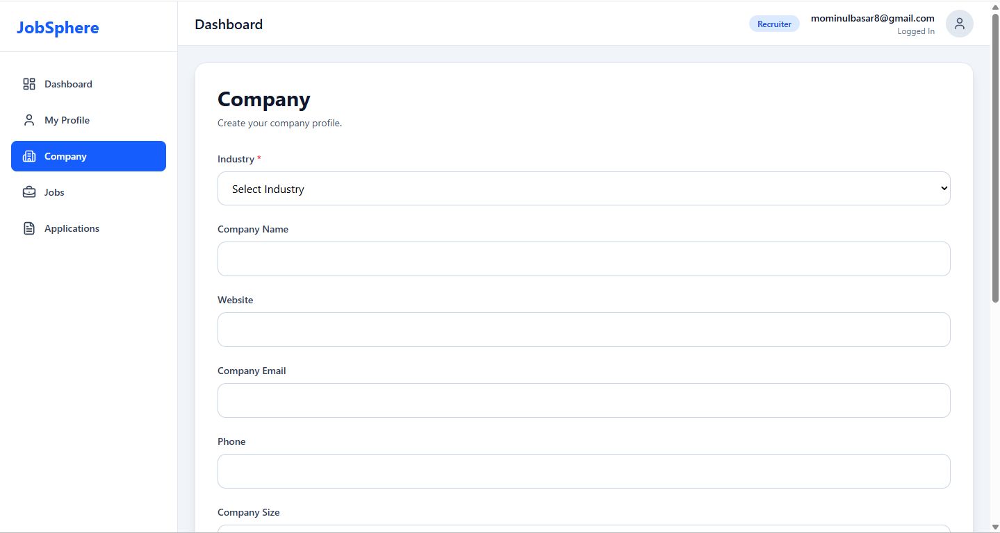
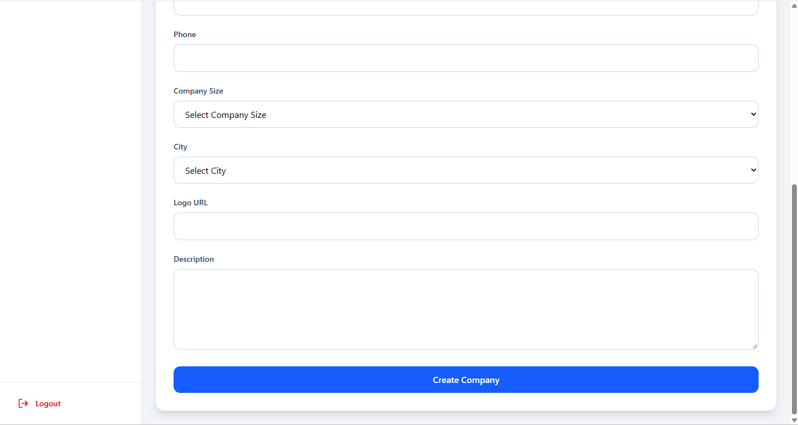
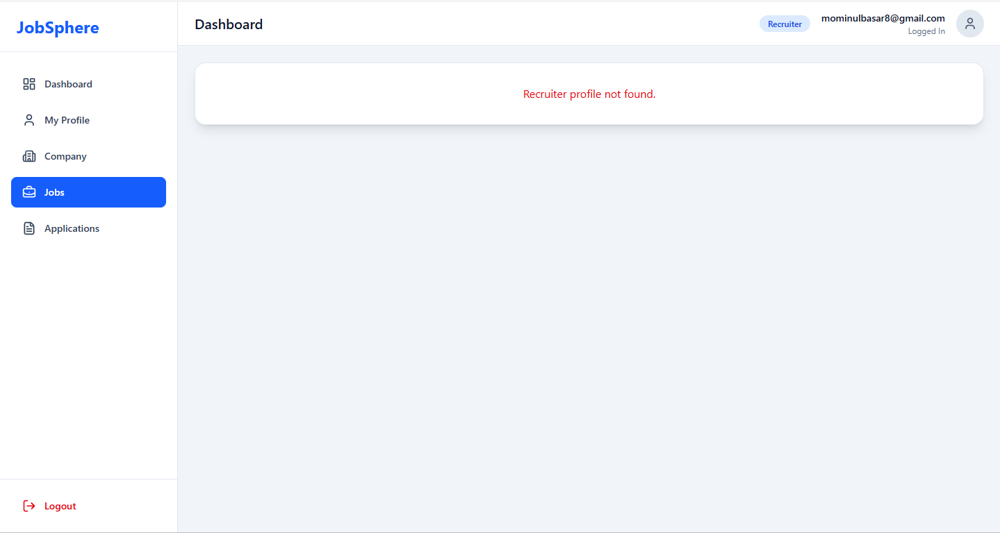
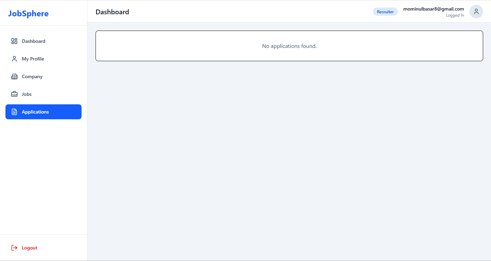

# JobSphere

A production-oriented full-stack recruitment platform built with **Laravel**, **React**, and **PostgreSQL**.

JobSphere enables candidates to discover and apply for jobs while allowing recruiters to create companies, publish job openings, and manage applications through a secure role-based workflow.

---

## Live Demo

**Frontend:** https://job-sphere-teal.vercel.app

**Backend API:** https://jobsphere-production-8d895004.up.railway.app

---

## Overview

JobSphere is a full-stack recruitment platform developed as a portfolio project to demonstrate modern web application development using Laravel and React.

The application follows a RESTful API architecture with Laravel powering the backend and React powering the frontend. It includes secure authentication with email verification, role-based authorization, relational database design using PostgreSQL, and deployment to a production environment.

The platform supports two primary user roles:

- **Candidate** — Browse jobs, save jobs, apply for positions, and track submitted applications.
- **Recruiter** — Create and manage company information, publish job openings, and review candidate applications.

The project emphasizes clean architecture, maintainable code, scalable database design, and production-oriented development practices.

---

## Key Features

### Authentication

- Email OTP verification
- Secure login and logout
- Laravel Sanctum authentication
- Role-based authorization
- Candidate and Recruiter accounts

### Candidate

- Browse available jobs
- Search and filter job listings
- View detailed job information
- Save jobs
- Apply for jobs
- Track submitted applications
- Candidate dashboard

### Recruiter

- Recruiter dashboard
- Create and manage company information
- Publish job openings
- Edit and update job postings
- Manage job listings
- Review candidate applications

### Platform

- RESTful API architecture
- PostgreSQL relational database
- Laravel Form Request validation
- Resource-based API responses
- Pagination support
- Protected API routes
- Production deployment
- Clean and organized project structure

---

## Technology Stack

| Category         | Technology                   |
| :--------------- | :--------------------------- |
| Frontend         | React 19, Vite, Tailwind CSS |
| Backend          | Laravel 12                   |
| Database         | PostgreSQL                   |
| Authentication   | Laravel Sanctum              |
| Email Service    | Resend                       |
| API              | REST API                     |
| HTTP Client      | Axios                        |
| State Management | React Context API            |
| Version Control  | Git & GitHub                 |
| Backend Hosting  | Railway                      |
| Frontend Hosting | Vercel                       |

---

## Project Screenshots

### Authentication

#### Register



#### OTP Verification Email



#### Login



---

### Recruiter Workflow

#### Recruiter Dashboard



#### Recruiter Profile



#### Create Company



#### Company Profile



#### Manage Jobs



#### Manage Applications



## Table of Contents

- [Project Structure](#project-structure)
- [Documentation](#documentation)
- [Getting Started](#getting-started)
- [Prerequisites](#prerequisites)
- [Installation](#installation)
- [Environment Variables](#environment-variables)
- [Running the Application](#running-the-application)

---

## Project Structure

```text
JobSphere/
├── client/                 # React frontend
├── docs/
│   ├── screenshots/
│   ├── API.md
│   ├── ARCHITECTURE.md
│   ├── ERD.md
│   ├── ROADMAP.md
│   └── SRS.md
├── server/                 # Laravel backend
├── .gitignore
├── LICENSE
└── README.md
```

---

## Documentation

Additional project documentation is available in the **docs** directory.

| Document          | Description                                      |
| :---------------- | :----------------------------------------------- |
| `SRS.md`          | Software Requirements Specification              |
| `ERD.md`          | Entity Relationship Diagram                      |
| `ARCHITECTURE.md` | System architecture and application architecture |
| `API.md`          | REST API documentation                           |
| `ROADMAP.md`      | Planned improvements and future releases         |

---

## Getting Started

Follow the steps below to run JobSphere locally.

---

## Prerequisites

Before you begin, make sure you have the following installed:

- PHP 8.2 or later
- Composer
- Node.js 20 or later
- PostgreSQL
- Git

---

## Installation

### 1. Clone the repository

```bash
git clone https://github.com/mbasar-8/JobSphere.git

cd JobSphere
```

---

### 2. Backend Setup

Move to the backend directory.

```bash
cd server
```

Install dependencies.

```bash
composer install
```

Create the environment file.

```bash
cp .env.example .env
```

Generate the application key.

```bash
php artisan key:generate
```

Update the database and email configuration inside the `.env` file.

Run the database migrations.

```bash
php artisan migrate
```

Start the Laravel development server.

```bash
php artisan serve
```

The backend will be available at:

```text
http://127.0.0.1:8000
```

---

### 3. Frontend Setup

Open a new terminal.

```bash
cd client
```

Install dependencies.

```bash
npm install
```

Create the environment file.

```bash
cp .env.example .env
```

Update the backend API URL if necessary.

Start the development server.

```bash
npm run dev
```

The frontend will be available at:

```text
http://localhost:5173
```

---

## Environment Variables

### Backend

Copy:

```bash
cp .env.example .env
```

Update the following values according to your local environment:

- Application URL
- PostgreSQL database credentials
- Resend API key
- Mail sender address

---

### Frontend

Copy:

```bash
cp .env.example .env
```

Configure:

```text
VITE_API_URL
```

This value should point to your Laravel API.

---

## Running the Application

Start the backend server.

```bash
php artisan serve
```

Start the frontend development server.

```bash
npm run dev
```

Open the application in your browser.

```text
http://localhost:5173
```

The React frontend communicates with the Laravel REST API running on your local machine.

## Deployment

The application is deployed as separate frontend and backend services.

| Service  | Platform   |
| :------- | :--------- |
| Frontend | Vercel     |
| Backend  | Railway    |
| Database | PostgreSQL |

---

## Production Environment

JobSphere Version 1 is deployed using a separated frontend and backend architecture.

- React frontend hosted on Vercel
- Laravel REST API hosted on Railway
- PostgreSQL production database
- Email verification powered by Resend
- Token-based authentication using Laravel Sanctum

---

## API Overview

The backend exposes a RESTful API consumed by the React frontend.

### Authentication

- Register
- Verify OTP
- Resend OTP
- Login
- Logout
- Authenticated User

---

### Candidate

- Candidate Profile
- Browse Jobs
- Job Details
- Saved Jobs
- Job Applications
- Dashboard

---

### Recruiter

- Recruiter Profile
- Company Management
- Job Management
- Application Management
- Dashboard

For detailed endpoint documentation, see:

```text
docs/API.md
```

---

## Database

JobSphere uses PostgreSQL with a normalized relational database design.

Core entities include:

- Users
- Candidate Profiles
- Recruiter Profiles
- Companies
- Jobs
- Applications
- Saved Jobs
- Skills
- Industries
- Countries
- Cities

The complete database design is available in:

```text
docs/ERD.md
```

---

## Architecture

The application follows a client-server architecture.

```text
React (Vite)
        │
      Axios
        │
Laravel REST API
        │
Laravel Sanctum
        │
 PostgreSQL
```

Additional architecture documentation is available in:

```text
docs/ARCHITECTURE.md
```

---

## Security

JobSphere implements several security best practices, including:

- Password hashing using Laravel Hash
- Email OTP verification
- Token-based authentication with Laravel Sanctum
- Role-based authorization
- Request validation using Laravel Form Requests
- Protected API routes
- Password confirmation during registration

---

## Development Goals

The primary goals of this project are to demonstrate:

- Full-stack application development
- REST API design
- Authentication and authorization
- Relational database design
- Production deployment
- Clean project architecture
- Maintainable and scalable codebase

## Known Limitations

Version 1 represents the initial production release of JobSphere. The core platform, including authentication, candidate workflow, recruiter workflow, and deployment, is fully functional. The following enhancements are planned for future releases.

### Production Email Registration

The production environment currently uses a limited email verification setup for demonstration purposes. Public email registration is temporarily restricted until a verified custom email sending domain is configured.

This enhancement is planned for Version 2 as part of the production email infrastructure improvements.

---

### Mobile Experience

Version 1 is primarily optimized for desktop browsers.

A fully responsive experience for mobile and tablet devices will be introduced in Version 2.

---

## Version 2 Roadmap

The following improvements are planned for the next major release.

### User Experience

- Modern UI/UX redesign
- Fully responsive layouts
- Improved navigation
- Better loading and error states
- Enhanced accessibility

---

### Authentication

- Verified custom email sending domain
- Public production email registration
- Improved account management

---

### Candidate

- Profile photo upload
- Resume/CV upload
- Portfolio link improvements
- Enhanced candidate profile

---

### Recruiter

- Recruiter profile photo
- Company logo upload improvements
- Additional company management features

---

### Administration

- Admin dashboard
- User management
- Company management
- Job moderation
- Platform analytics

---

### Platform

- File upload management
- Performance optimization
- Additional security improvements
- Continued feature enhancements

---

## Project Status

**Current Release:** Version 1.0.0

**Status:** Active Development

JobSphere will continue to receive improvements, new features, and usability enhancements in future releases.

---

## Contributing

Contributions, suggestions, and feedback are welcome.

If you discover a bug or have an idea for improving JobSphere, feel free to open an issue or submit a pull request.

Before contributing, please ensure that your changes are well documented and follow the existing project structure and coding style.

---

## License

This project is licensed under the MIT License.

See the **LICENSE** file for more information.

---

## Author

**Mominul Basar**

- GitHub: https://github.com/mbasar-8
